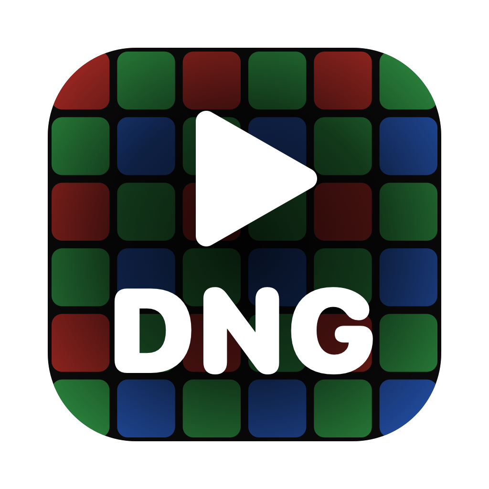

# DNGPlayer

Lightweight macOS viewer and player for CinemaDNG raw sequences. Built for footage from the original Blackmagic Pocket Cinema Camera.



## Features

- Opens a folder and lists every clip (one subfolder of `.dng` frames per clip)
- Real-time playback with the clip's `.wav` as sync clock; frame rate read from the DNG `FrameRate` tag
- **Video** mode (standard Rec.709 rendering) and **Film** mode (flat log look)
- Exposure ±4 EV, half-resolution decode, scrubbing, frame stepping
- Space: play/pause · ←/→: single frame

## Build

Requires macOS 14+ and the Xcode Command Line Tools. No Xcode project, no dependencies.

```sh
./build.sh
```

This compiles `DNGPlayer.swift` and installs `DNGPlayer.app` in `/Applications`. The build is ad-hoc signed, so it runs on the Mac that built it.

To redraw the icon: `swift make-icon.swift && ./build.sh`.

Self-check (scan, frame rate tag, decode timing):

```sh
/Applications/DNGPlayer.app/Contents/MacOS/DNGPlayer --check /path/to/footage
```

## Limitations

- Raw development uses Apple's Core Image, not Blackmagic colour science. Good for reviewing footage, not for judging a grade.
- Film mode is an approximated log curve, not the official Blackmagic Film curve.

## License

No license. © 2026 the author, all rights reserved. The source is published for reference: you may not copy, modify, redistribute or sell it without written permission.

Not affiliated with Blackmagic Design or Adobe. CinemaDNG is a trademark of Adobe.
